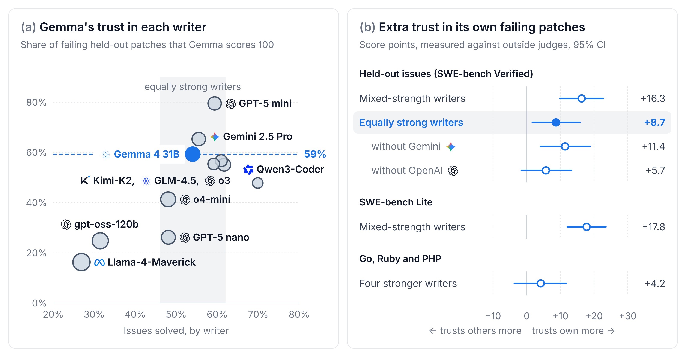

<h1 align="center">Neither Gemma 4 nor the Existing Tests Catch Wrong Fixes</h1>

<p align="center">
  Gemma 4 gives full marks to failing patches from equally strong agents as often as to its own.
  Seven in ten failing patches from 32 public models pass every existing test, and on one issue in ten the correct fix
  breaks one.
</p>

<p align="center">
  <a href="paper/rubber-stamp.pdf"></a>
  <a href="paper/rubber-stamp-supplement.pdf"></a>
  <a href="https://huggingface.co/datasets/vein05/gemma4-paper-track-data"></a>
  <a href="https://www.kaggle.com/competitions/gemma-4-developer-agent-paper"></a>
</p>

<p align="center">
  <br>
  
  <br><br>
</p>

## What we found

Coding agents often decide whether a patch is finished by asking a model, often the one that wrote it. We asked Gemma 4
31B and eight other models to score SWE-bench patches without naming their writer, and graded every patch with the
hidden tests. Gemma's extra trust in a patch is its score minus the mean score of judges from other model families.

- **Gemma 4's self-preference halves against equally strong writers.** By the usual measure, against five public
  agents of mixed strength, Gemma's extra trust in its own failing patches is 16.3 points. Against the seven public
  agents that solve about as many held-out SWE-bench Verified issues as Gemma, chosen by a rule fixed before scoring,
  it is 8.7 points. Gemma gives these seven agents' failing patches the top score as often as its own.
- **Gemma gives the top score to most strong writers' failing patches.** On Go, Ruby and PHP issues it scores 100 on
  76% of its own failing patches and on 68% of four stronger agents' failing patches. Most of its own failing patches
  are wrong fixes that pass every existing test. Thinking before scoring, testing the patch in a shell and LoRA
  fine-tuning each left most of them approved.
- **Gemma obeys outdated tests when it repairs a patch.** Shown the existing tests its patch breaks, Gemma repairs 14
  of 26 held-back failing patches on the held-out issues, against 7 after a second look. On SWE-bench Lite, the
  reference fix fails the same tests for every held-back correct patch. There Gemma breaks 12 of 14 correct patches,
  against 2 after a second look.

## Reproduce

```
./reproduce.sh main
```

This recomputes the main paper's claims from the released data and prints each one next to the paper's value. It takes
about three minutes, needs no GPU and calls no model. It downloads only the files those analyses read: 92 MB of the
2.1 GB Hugging Face dataset, plus Gemma's SWE-bench Lite patches from the team that published them. The run fails if
any downloaded file goes unread. Everything goes into `.reproduce/`, and the repository's own files stay as they are.
It needs `uv`, or Python 3.11 or newer.

`./reproduce.sh supplement` and `./reproduce.sh all` are not written yet.

## What is here

| Path | What it is |
|---|---|
| [`paper/rubber-stamp.pdf`](paper/rubber-stamp.pdf) | The paper. |
| [`paper/rubber-stamp-supplement.pdf`](paper/rubber-stamp-supplement.pdf) | Setup, judge prompt, grading checks, every test and its cost. |
| [`paper/writeup.md`](paper/writeup.md) | The paper as Markdown, the PDF's source (`cd paper && make` rebuilds it). |
| [`scripts/`](scripts/) | Agent runs, grading, judging, repair and every analysis; `scripts/derived/` holds each judge answer and number. |
| [`data/`](data/) | Gemma 4 31B's agent runs, its contest programs and the public patches we judged (see `data/README.md`). |
| [Hugging Face: `vein05/gemma4-paper-track-data`](https://huggingface.co/datasets/vein05/gemma4-paper-track-data) | The raw runs too large for this repository, and every judge prompt. |

## Compute

The project used about 113 GPU-hours, 97 on one A100 80 GB and 15 on L40S. At RunPod on-demand prices this compute
costs about $191. API judging through OpenRouter is listed in the supplement (Section G).

## License

The code is under the [Apache License 2.0](LICENSE). Third-party data in `data/public/` keeps its source's terms
([`data/README.md`](data/README.md)).

## AI disclosure

Claude Opus 5.5 was used in this project.
