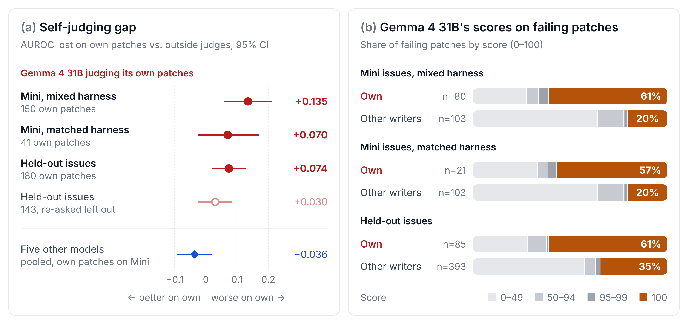
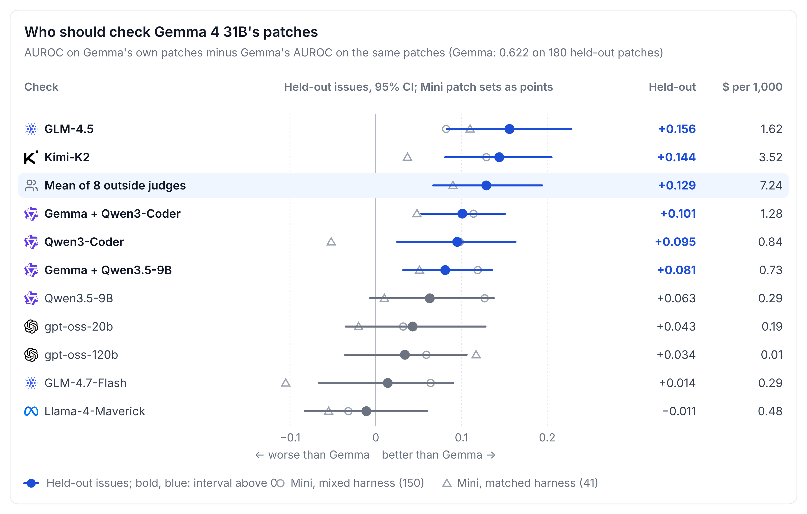

# Rubber Stamp: Gemma 4 Scores Its Own Failing Patches as Sure to Pass

**Subtitle.** Nine open models judged SWE-bench Verified patches without being told who wrote them. Gemma 4 31B gives
the top score to about 60% of its own failing patches, on two issue sets and in two agent harnesses. A stronger
outside judge is the better check.

Status: draft of 2026-10-06, written from `changelog/2026-10-05.md` and `changelog/2026-10-06.md`. Every number
traces to a file in `scripts/derived/`. Items to finish before submission are listed at the end.

## Abstract

An agent that checks its own patch decides when to stop, retry or ask a person. Nine open models scored the chance
that a patch passes the hidden tests of its SWE-bench Verified issue, without being told the author. Gemma 4 31B's
patches came from four agent harnesses on 50 issues, and from mini-SWE-agent, the harness of every other writer, on
the same 50 issues and on 193 held-out issues.

In all three sets Gemma gives a score of 100 to 57% to 61% of its own failing patches, against 20% to 35% of other
writers' failing patches. Outside judges scoring the same patches do not follow it. On the held-out issues, Gemma's score
exceeds theirs by 16.6 points [10.3, 23.1] more on its own failing patches than on other writers', with no such
excess on passing patches.

Gemma also ranks its own patches less accurately than outside judges do. Once the harness is matched, this gap is
about half the size we first measured, and on the held-out issues it holds only when judges may write longer answers.
Five other models show no such gap. As a check of Gemma's patches, GLM-4.5 or Kimi-K2 raises AUROC by 0.14 to 0.16; a
9-billion-parameter judge alone does not.

## 1. Introduction

Coding agents end a task by deciding that their patch is done. Many agents and agent papers ask the same model to
judge its own work, for example to pick among attempts or to decide when to stop. That works only if the model judges
its own patches as well as it judges anyone else's.

We measured this for Gemma 4 31B, the model of this competition, and for five other open models. Each judge saw an
issue and one patch, wrote a short explanation, and gave a 0 to 100 score for the chance that the patch passes the
hidden tests. The prompt never named the author. We compare each judge's scores on its own patches with its scores on
other writers' patches, and subtract the same comparison for outside judges, judges from a different model family
than the writer.

Our first look used public Gemma patches from four harnesses, while every other writer's patches came from
mini-SWE-agent, so harness and model were confounded. We then ran Gemma 4 31B in mini-SWE-agent ourselves, on the same
50 issues and on 200 held-out issues, under a plan written before the runs.

Findings:

1. Gemma rubber-stamps its own failing patches in all three patch sets, and outside judges do not (Section 3.1).
2. Matching the harness halves Gemma's self-judging gap, from +0.135 to about +0.07 (Section 3.2).
3. Five other models judge their own patches as well as outside judges do (Section 3.3).
4. A stronger outside judge ranks Gemma's patches about as well as Gemma ranks other writers' patches (Section 3.5).

## 2. Setup

**Patch sets.** Other writers' patches are public mini-SWE-agent submissions by GLM-4.5, gpt-oss-120b, Kimi-K2,
Llama-4-Maverick, Qwen3-Coder and, on the Mini issues, Devstral
([SWE-bench experiments](https://github.com/SWE-bench/experiments)), with official labels. Test files were removed
from every patch, and patches over 30,000 characters were dropped.

| Patch set | Issues | Gemma's patches | Rated by all nine judges (Gemma's / other writers') |
|---|---|---|---|
| Mini issues, mixed harness | 50 (django, sphinx) | public runs in SWE-agent, openclaw, opencode, zeroclaw | 150 / 183 |
| Mini issues, matched harness | the same 50 | ours, mini-SWE-agent, one attempt per issue | 41 / 183 |
| Held-out issues | 193 of 200, 11 repositories | ours, mini-SWE-agent, one attempt per issue | 180 / 777 |

The Mini issues are the 50 issues of SWE-bench Verified Mini
([dataset](https://huggingface.co/datasets/MariusHobbhahn/swe-bench-verified-mini)). Mixed-harness patches come from
public third-party runs ([AlphaDiana datasets](https://huggingface.co/n-pelleriti)). The held-out issues are a fixed
random sample of SWE-bench Verified issues outside the Mini issues. For our own runs, the 4-bit competition checkpoint
of Gemma 4 31B ran in mini-SWE-agent v1.7.0 with its SWE-bench configuration unchanged, temperature 0, served by vLLM
on one NVIDIA L40S. We graded these patches with SWE-bench's grading code in Apptainer containers. We kept an issue
only if its reference patch resolves in our environment, which dropped 7 of the 200 held-out issues. Gemma resolved 98
of the 193 kept issues (50.8%).

**Judges.** Nine models judged every patch: Gemma 4 31B, gpt-oss-20b, Qwen3.5-9B, GLM-4.7-Flash, and the five writers
above other than Devstral. All calls went through OpenRouter at temperature 0 with the model's internal reasoning
switched off, except gpt-oss, which always reasons and ran at low effort. Gemma as judge is the hosted full-precision
model. The prompt contains the issue text and the patch. Answers end with a score line. An answer without one was
re-asked once, with an 8,000-token output limit for the new patch sets and 3,000 for the mixed-harness set. Other
writers' patches on the Mini issues keep their scores from the mixed-harness set. Analyses
use the patches that all nine judges scored.

**Measures.** AUROC is the probability that a judge scores a randomly chosen passing patch above a randomly chosen
failing one, with ties counted as half. A model's self-judging gap is its AUROC on other writers' patches minus its
AUROC on its own, minus the same drop for outside judges. Leniency is a judge's score on a patch minus the mean score
of outside judges on the same patch. We report it as the difference between a model's own failing patches and other
writers' failing patches. The rubber-stamp rate is the share of a judge's own failing patches scored 100. All
intervals are 95% intervals from 2,000 bootstrap resamples of issues.

**Plans.** Each test had a written plan with its reading rule before its data was computed
(`spec/self-judging-replication.md`, `spec/own-patch-mechanism.md`, `spec/self-check-fix.md`,
`spec/fresh-replication.md`, `spec/mini50-same-harness.md`, `spec/outside-judge-check.md`). The plan for the new
patch sets was committed on 2026-10-05, before the agent runs. Two changes came after it, both before any nine-judge
score was read. We added the leniency measure, and we raised the re-ask limit to 8,000 tokens because many answers
stopped at 3,000 before the score line. Analyses chosen after we saw a result are marked
exploratory.

## 3. Results

**Figure 1.** (a) Gemma 4 31B's self-judging gap on each patch set, with 95% intervals. The open circle leaves out
every held-out patch that needed a re-ask (exploratory). The diamond is the pooled gap of five other models judging
their own patches on the Mini issues. (b) Gemma's scores on failing patches written by Gemma (own) and by the other
writers, per patch set.

### 3.1 Gemma rubber-stamps its own failing patches

| Patch set | Own failing patches scored 100 | Other writers' failing patches scored 100 | Leniency on failing patches [95%] |
|---|---|---|---|
| Mini issues, mixed harness | 61% (49 of 80) | 20% (of 103) | +20.9 [11.5, 30.2] |
| Mini issues, matched harness | 57% (12 of 21) | 20% (of 103) | +11.7 [−1.4, 24.2] |
| Held-out issues | 61% (52 of 85) | 35% (of 393) | +16.6 [10.3, 23.1] |

The rubber-stamp rate does not move with the harness or the issues. Part of it comes from the patches, since some
outside judges also give Gemma's failing patches 100 more often than other writers' failing patches (on the held-out
issues, GLM-4.7-Flash 37% against 25%). Leniency removes this part by comparing judges on the same patch. Gemma still scores its own failing held-out patches 16.6 points higher than outside judges do, relative to
other writers' failing patches. On passing patches the same difference is +3.4 [−2.0, 8.0], so the excess lies on the
patches Gemma should reject. The Mini set with matched-harness patches has 21 failing patches, too few for a clear
interval.

The held-out result does not depend on the re-ask. Leaving out every patch whose answer needed one, Gemma's leniency
on its own failing patches is still +11.1 [3.8, 18.2] (exploratory).
Sources: `derived/fresh_replication_2026-10-06.json`, `derived/mini50_2026-10-06.json`,
`derived/fresh_replication_reasked-left-out-all_2026-10-06.json`.

### 3.2 The ranking gap is smaller once the harness is matched

| Patch set | Gemma's AUROC, own patches | Gemma's AUROC, other writers' | Self-judging gap [95%] |
|---|---|---|---|
| Mini issues, mixed harness | 0.636 | 0.833 | +0.135 [0.060, 0.210] |
| Mini issues, matched harness | 0.695 | 0.833 | +0.070 [−0.024, 0.168] |
| Held-out issues | 0.622 | 0.751 | +0.074 [0.022, 0.126] |

On the same 50 issues, matching the harness raises Gemma's AUROC on its own patches to 0.695. The outside judges'
drop on Gemma's patches stays the same (0.063 and 0.068). About half of the first gap therefore came from the harness that wrote
Gemma's patches, not from Gemma as judge. With 41 patches, the matched-harness interval is too wide for our reading rule
to call it either way.

On the held-out issues, the gap meets the rule we fixed in advance, a lower bound above zero and an estimate of at
least half the first gap, with little margin. It depends on the longer re-ask. Leaving out every patch that needed a
re-ask gives +0.030 [−0.024, 0.083] on 143 of Gemma's patches (exploratory). The left-out patches are those the judges reasoned about longest, and
without them Gemma's own AUROC rises from 0.622 to 0.670. Keeping them is the less selective estimate, but it rests on
a change made after the plan was fixed.

### 3.3 Only Gemma shows the gap

On the Mini issues, five of the other writers judged their own mini-SWE-agent patches, so harness is matched for them
by construction.

| Model judging its own patches | AUROC, own patches | AUROC, other families' patches | Self-judging gap [95%] |
|---|---|---|---|
| Qwen3-Coder | 0.691 | 0.786 | −0.032 [−0.241, 0.189] |
| gpt-oss-120b | 0.860 | 0.701 | −0.046 [−0.133, 0.049] |
| GLM-4.5 | 0.757 | 0.752 | −0.047 [−0.174, 0.116] |
| Kimi-K2 | 0.881 | 0.805 | −0.036 [−0.113, 0.036] |
| Llama-4-Maverick | 0.786 | 0.657 | −0.019 [−0.133, 0.101] |

Pooled over the five, the gap is −0.036 [−0.089, 0.016] (`derived/self_judging_replication_2026-10-05.json`).

### 3.4 What the rubber-stamping is not

These checks use the mixed-harness patches on the Mini issues (`derived/own_patch_mechanism_2026-10-05.json`,
`derived/own_patch_mechanism_think_2026-10-05.json`).

- **Patch size.** Gemma's patches are much smaller than the other writers' (7.7 against 72.7 added lines on average).
  Among single-file failing patches of similar size, Gemma's leniency on its own stays 24.1 points [12.7, 39.9] above
  its leniency on other writers' patches.
- **Missing reasoning.** With Gemma's thinking switched on, its AUROC on its own patches is 0.638 against 0.636 with
  reasoning off, and it still scores 64% of its own failing patches at 95 or above.
- **Issues it cannot solve.** It scores two thirds of its failing patches at 95 or above whether or not one of its
  attempts solved the issue (66% and 67%).
- **Choice among its own attempts.** On two of its own patches for the same issue, Gemma picks the passing one about as
  often as outside judges do (47 pairs). On pairs from different issues it falls behind them by 0.070 [0.006, 0.138]
  in pair accuracy. Breaking its ties at 100 perfectly would raise its AUROC from 0.64 to 0.91.

### 3.5 Who should check Gemma's patches

**Figure 2.** Each check's AUROC on Gemma's own patches minus Gemma's AUROC on the same patches. Lines are 95%
intervals on the 180 held-out patches; hollow points are the two Mini patch sets. "Gemma + X" averages the two
judges' percentile ranks. Cost is the OpenRouter price per 1,000 patches in US dollars. Exploratory: the plan was
written after the per-judge AUROCs on the held-out patches had been printed
(`derived/outside_judge_check_2026-10-06.json`).

On the held-out patches, GLM-4.5 ranks Gemma's patches better than Gemma does by 0.156 [0.083, 0.228], and Kimi-K2
by 0.144 [0.081, 0.205]. The mean of all eight outside judges does as well. All three stay above zero after a
Bonferroni correction over eight judges. The two judges reach about the accuracy Gemma has on other writers' patches.

A small judge alone is not enough. Qwen3.5-9B beat Gemma by 0.127 on the mixed-harness patches, but its interval on
the held-out patches includes zero. Its earlier advantage came from the patch set whose harness also inflated the gap.
Averaging its ranks with Gemma's does help, by 0.081 [0.032, 0.136] on the held-out patches. Llama-4-Maverick is no
better than Gemma on any set. We cannot tell whether the strong judges help because they come from another family or
because they judge better in general. Kimi-K2 was also the most accurate judge of all patches on the Mini issues.

Gemma's own signals do less. On the mixed-harness patches, its score plus agreement between its attempts at an issue
raised AUROC by 0.074 [−0.014, 0.160], short of our planned bar, and switching thinking on changed nothing
(`derived/self_check_fix_2026-10-05.json`). We could not test attempt agreement on the new sets, which have one
attempt per issue.

## 4. What this means for agents built on Gemma 4

Choosing among several attempts at one issue uses only the ranking within that issue, where we found no deficit. Other
decisions need a score that means the same across issues: whether to submit a patch, open a pull request, or hand it
to a person. There Gemma's score is least informative where it matters, because it gives most of its failing patches
the same top score as its passing ones.

In this competition, an empty patch scores the same as a wrong one, and the scorer runs one Gemma model on one task at
a time, so abstaining gains nothing. The finding matters outside the leaderboard: an engineer deciding which Gemma
patches to trust should ask a stronger model, or at least combine Gemma's score with a second judge's.

## 5. Related work

Judges that favor their own outputs have been studied mostly on text and short programs. Panickssery et al. (2024)
link the strength of this self-preference to how well a model recognizes its own summaries. Wataoka et al. (2024)
relate it to the perplexity of the preferred response. Roytburg et al. (2026) compare a judge's own failing answers
with other models' failing answers to the same question, and much of the measured self-preference goes away. Our
leniency measure also compares judges on the same patch. Chen et al. (2025) find that stronger judges more often
prefer their own wrong answer to a correct one.

Two studies are closest to ours. Pombal et al. (2026) check programs from twelve models against unit-test rubrics and
find that judges favor their own outputs even with objective rubrics. On LiveCodeBench, Gemma 3 12B and 27B do not:
their ratios are 0.97 and 1.03, where 1 means no self-preference. Khullar et al. (2026) find that a model rates a
SWE-bench patch as more correct when it is framed as the model's own earlier answer. When the patch is shown in a user
turn, their ratings separate passing from failing patches with AUROC 0.99, for one unnamed model and with no comparison
to other writers' patches.

Our setting differs in three ways. The patches come from full agent runs, the judge sees no authorship or framing cue,
and we measure ranking accuracy against hidden tests with outside judges as the control. In this setting five of six
models judge their own patches as well as outside judges do, while Gemma 4 does not, unlike the Gemma 3 models Pombal
et al. tested.

## 6. Limitations

- **One model shows the effect.** The finding is about Gemma 4 31B. We do not know which part of its training causes
  it, or whether it recognizes its own patches or shares the mistakes in them.
- **Writer and judge precision differ.** Our new Gemma patches come from the 4-bit competition checkpoint; Gemma as
  judge is the hosted full-precision model. In an earlier one-word check on 173 other patches, the two gave the same
  answer in 331 of 344 calls.
- **Labels from two sources.** Other writers' labels are SWE-bench's official ones; our Gemma patches were graded in
  our environment. On 30 issues, 26 control patches matched their official label; the misses came from rebuilt images
  and environment faults, and every issue we kept has a reference patch that resolves there.
- **One attempt per issue** on the new sets, so Gemma's own pass/fail pairs all come from different issues.
- **Changes after the plan.** The leniency measure and the 8,000-token re-ask were added after the plan was fixed;
  the held-out ranking gap depends on the second.
- **Small matched-harness Mini set.** 41 of Gemma's patches; its intervals are wide.

## 7. Reproducibility and cost

All data are public, and no competition data was sent to an outside service. Code, prompts, plans, per-call judge
outputs, Gemma's new patches and their labels are in this repository. Judging runs `scripts/self_preference.py` and
`scripts/fresh_judging.py`. The analyses are `scripts/self_judging_replication.py`, `scripts/own_patch_mechanism.py`,
`scripts/self_check_fix.py`, `scripts/fresh_judging.py analyze`, `scripts/mini50_analysis.py` and
`scripts/outside_judge_check.py`.

Gemma's 250 new agent runs took 49 agent-hours, five at a time on one NVIDIA L40S of a university cluster, at no
charge. API cost, as reported by OpenRouter per call (sums of the `cost` field in `scripts/derived/`):

| Run | Calls | Cost (USD) |
|---|---|---|
| Four judges on Gemma's own attempts (ratings reused here) | 3,244 | 0.53 |
| Nine judges on the Mini issues, mixed harness, reasoning off | 3,292 | 2.66 |
| Gemma 4 31B with thinking on, Mini issues | 401 | 0.51 |
| Nine judges on the held-out and matched-harness patches | 9,857 | 8.66 |
| **This study** | **16,794** | **12.36** |

gpt-oss-120b calls were reported at zero cost by their provider. Earlier experiments of this project on other
questions cost 9.27.

## Before submission (not part of the writeup)

1. Grade the second `django__django-11848` patch (needs a Magnolia job, see `changelog/2026-10-06.md`), run
   `scripts/mini50_analysis.py` again without `--drop`, and update Sections 3.1 and 3.2 and Figure 1.
2. Calibrated scorer: last run 2026-10-05 on the earlier draft (4.02 ± 0.19); run it again on the final version.
3. Word count (3,000 at most), AI-use disclosure, public repository link.
4. Check the related-work paragraph against the changed framing (rubber-stamping first, gap second).
