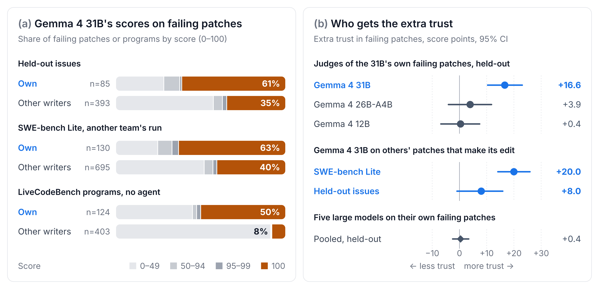
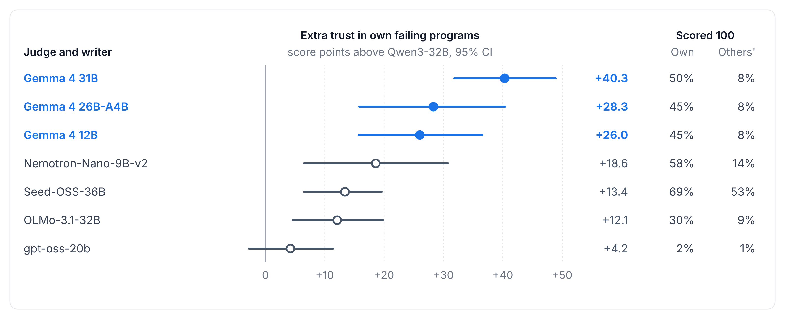
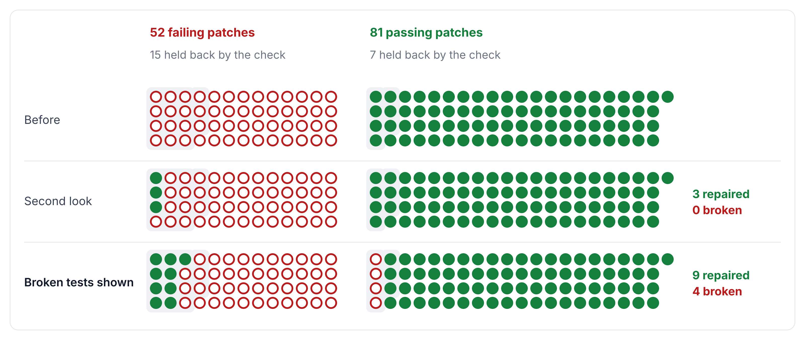

# Gemma 4 Gives Its Failing Patches Full Marks

<!-- kaggle-subtitle: Gemma 4 gives most of its own failing patches the top score when it judges them without being
told who wrote them. Most of the trust stays when Gemma checks harder, and failing repository tests let it repair some of these
patches. -->

## Abstract

Coding agents often decide whether a patch is finished by asking the model that wrote it. This check assumes that
the model judges its own patches as well as other models' patches. Earlier work found that most judges favor their own
contest programs, but Gemma 3 12B and 27B do not. In this work, we ask Gemma 4 31B and other models to score SWE-bench
Verified patches without naming their writer, and we compare each judge with judges from other model families on the
same patch. Gemma gives its top score to 52 of its 85 failing patches, while the other judges score the same patches
lower. Most small open models we tested are also lenient on their own contest programs. Five large models show no leniency on their own repository patches. On one of two data sets, Gemma also trusts other models' failing patches that make the same edit. Most of the trust stays when Gemma thinks before
scoring, tests the patch in a shell, or is fine-tuned on labeled patches. When an agent shows Gemma the repository tests
that its patch breaks, Gemma repairs 9 of the 52, but it also breaks 4 correct patches. Gemma's score alone should not decide whether its patch is finished. We release everything we ran, including every agent and judge trace, on [GitHub](https://github.com/Vein05/gemma4-paper-track) and [Hugging Face](https://huggingface.co/datasets/vein05/gemma4-paper-track-data).

## 1. Introduction

In matplotlib issue 24570, Gemma 4 31B wrote a patch that fixes the reported alignment bug but also swaps the left
and right cases of a shared helper. When we later asked Gemma whether this patch would pass the project's hidden
tests, it gave the highest score on our 0 to 100 scale and called the patch "a simple swap" that "correctly implements the expected
behavior". GLM-4.5 scored the same patch 20 because it "breaks VPacker by reversing left and right", and the hidden
tests for left and right alignment fail. Coding agents make this call at the end of every task, and many make it by asking the model that wrote the patch.

We call this failure rubber-stamping: a judge gives its own failing patch the top score. On LiveCodeBench contest
programs, Pombal et al. (2026) found that most judges favor their own programs, but Gemma 3 12B and 27B do not. On the
same benchmark, Gemma 4 31B gives the top score to half of its failing programs and to 8% of other writers'. It also
rubber-stamps on SWE-bench Verified issues it attempted with mini-SWE-agent, and on another team's Gemma run on
SWE-bench Lite. We compare Gemma with outside judges, models from families other than Gemma that score the same
patches, and they do not share this trust.

On average, Gemma scores other writers' failing patches below the outside judges, so it does not score every failing patch high. On Lite, it also trusts failing patches from other models that make the same edit as its own. One reading is that Gemma
trusts the fix itself, but we cannot rule out that it recognizes its own patches. Checks that Gemma runs itself leave
most of the trust in place. Showing Gemma the repository tests its patch breaks repairs more patches than a plain second look.

We make the following contributions:

- **Gemma 4 31B rubber-stamps its failing patches.** On held-out SWE-bench Verified issues, it gives the top score to
  52 of its 85 failing patches, while outside judges score the same patches lower. Five of six other small open models are also lenient on their own contest programs. Five large models show no leniency on their own repository patches (Section 3.1).
- **Gemma's trust reaches other writers' patches that make its edit.** On SWE-bench Lite, Gemma's extra trust in those patches
  over other failing patches is 20 points. The same test on our held-out issues is inconclusive (Section 3.2).
- **Tests that Gemma did not write let it repair some patches.** Shown the repository tests its patch breaks, Gemma
  repairs 9 of the 52 rubber-stamped failing patches, against 3 after a plain second look. The same step breaks 4
  correct patches (Section 3.4).

## 2. Setup

**Patches.** The main data set is 193 held-out issues, a random sample of SWE-bench Verified issues (Jimenez et al.,
2023) outside SWE-bench Verified Mini (MariusHobbhahn). We call the model that wrote a patch its writer. The 4-bit
competition checkpoint of Gemma 4 31B made one attempt per issue in mini-SWE-agent v1.7.0 (SWE-agent) at temperature
0, and we graded its patches with SWE-bench's grading code. We kept an issue only if its reference patch passes in
our environment, which kept 193 of 200. Other writers' patches are public mini-SWE-agent submissions (SWE-bench
experiments) by GLM-4.5, gpt-oss-120b, Kimi-K2, Llama-4-Maverick and Qwen3-Coder, with their official labels. We
removed test files from every patch and dropped very long patches.

Two more data sets test whether the result depends on our run. Another team ran Gemma 4 31B on the 300 SWE-bench
Lite issues, in mini-SWE-agent 2.2.1 at full precision with thinking on. LiveCodeBench is a different kind of task: our checkpoint wrote one program per contest problem with no agent. On the 50 Mini issues, Gemma's patches from four public harnesses
(n-pelleriti), including SWE-agent (Yang et al., 2024), give the same picture (Supplement, Section C).

**Judges.** Nine models scored every held-out patch: Gemma 4 31B, gpt-oss-20b, Qwen3.5-9B, GLM-4.7-Flash and the
five writers above. Each judge saw the issue and one patch, without its writer, and scored the chance that the patch
passes the hidden tests from 0 to 100. Calls went through OpenRouter at temperature 0 with reasoning off, except for
gpt-oss, which always reasons and ran at low effort. Credit limits left fewer judges on Lite and
LiveCodeBench, before any score was read.

**Measures.** A judge's score on a failing patch says little alone, because some failing patches look right to
everyone. We therefore subtract the outside judges' mean score on the same patch from the judge's score. Extra trust compares
two groups of failing patches on this difference. Unless we name another group, the comparison is with other writers'
failing patches. A judge with extra trust in its own failing patches is lenient on them. We
report 95% intervals from 2,000 bootstrap resamples of issues. The
rubber-stamp rate is the share of a judge's own failing patches that it scores 100.

**Plans.** We committed a written plan, with the rule for reading its result, before computing each test. We mark as
exploratory every analysis chosen after we saw a result.

## 3. Results

**Figure 1.** (a) Gemma's
scores on failing patches, its own and other writers', on three data sets. (b) Extra trust in failing patches, in
score points with 95% intervals. In the two same-edit rows, the comparison is other writers' failing patches without
Gemma's edit.

### 3.1 Gemma rubber-stamps its failing patches

Gemma gives 100 to about half or more of its failing patches on all three data sets, and to far fewer of other
writers' failing patches (Figure 1a). The outside judges do not share this trust. On the held-out issues, Gemma scores its own failing patches about 14 points above the outside judges and other
writers' failing patches about 3 points below them, an extra trust of 16.6 points [10.3, 23.1]. The same holds on Lite and LiveCodeBench, where both intervals lie above zero.
Gemma's failing patches do look a little better to everyone, so we also compared them only
with other writers' failing patches that the outside judges score the same. The held-out extra trust is still +13.6,
and its interval stays above zero (exploratory, Supplement, Sections C and D).

The failure reaches beyond this one model. On LiveCodeBench, five of six other usable small open models, including Gemma 4 12B and 26B-A4B, are lenient on their own failing programs, and Gemma 4 31B has the largest estimate (Figure 2).
These models share no outside panel, so Qwen3-32B is the only reference judge here. Seed-OSS-36B gives 100 to most failing programs, its own or not.

**Figure 2.** Extra trust (exploratory) is own failing minus other writers' failing programs, in score points above Qwen3-32B. We set
aside GLM-4-9B and Phi-4-mini after reading their results, because they pass almost no problems (Supplement,
Section C).

Five large models judged their own held-out patches in the same way, and none shows extra trust like Gemma's (exploratory, Figure 1b,
Supplement, Section C).

### 3.2 The trust reaches other writers' patches that make Gemma's edit

Gemma could trust its patches because it recognizes them as its own, or because it believes in the edit they make.
We fixed a test before computing it, and it needed support from both data sets. We split other writers' failing patches by whether they change nearly the same lines
as Gemma's failing patch for that issue. On Lite, Gemma's extra trust in the same-edit
patches over the others is 20.0 points (Figure 1b). On the held-out issues the estimate is smaller,
and its interval reaches zero. We detect no extra trust in Gemma's own patch beyond these same-edit patches
on either set, but few issues have both kinds of patch. The edit explanation is therefore supported on Lite
and inconclusive on the held-out issues (Supplement, Section D).

We also tested whether the trust belongs to the Gemma family. Gemma 4 12B and 26B-A4B scored the 31B's held-out patches, and neither shows measurable extra trust in its failing ones (Figure 1b). The same two models are lenient on contest programs they wrote themselves (Figure 2). Coming from the same family does not produce this trust (Supplement, Section D).

The trust is not limited to Gemma's own fixes. On Lite, Gemma trusts failing patches by Claude 4 Sonnet, one of that
data set's other writers, about as much as its own (Supplement, Section C). Our data cannot tell the fix Gemma would write from
the fix most strong models would write. We also never varied the writer with the patch held fixed, so we cannot rule
out that Gemma recognizes its own patches.

### 3.3 Checking harder through Gemma leaves most of the trust in place

A check that Gemma runs itself may inherit this trust. We tested four such checks.

| Check run by Gemma | What happens to Gemma's failing patches |
|---|---|
| Thinking before scoring (Mini issues) | still scores 62% of its failing patches 100, against 61% without thinking |
| Its own reproduction script, written while fixing the issue | the last run ends without an error in almost all failing runs that ran one |
| A shell with the patch applied; Gemma must write a test that fails without it | on the 52 failing held-out patches it had scored 100, still scores 80% at 100 |
| LoRA fine-tuning on labeled patches from other issues | on separate held-out and Lite issues, still accepts almost all the failing patches it had scored 100 |

The shell runs had the repository's environment active, and in most of them on failing
patches Gemma wrote a test that fails without the patch and passes with it. The shell lowers Gemma's score more often on failing patches than on
passing ones, but it separates them only slightly (AUROC 0.58). The LoRA adapter did not reduce the failing
patches Gemma accepts on new issues by a measurable amount (one seed, Supplement, Section E).

### 3.4 Tests that Gemma did not write let it repair some patches

The repository's existing tests encode what the project's developers expected. We gave the agent a check that needs
no hidden test and no second model. It picks the existing tests whose files or functions match the changed code,
runs them twice before the patch and once after, and holds back the patch if a test that passed both times now
fails or disappears. A held-back patch gets one more Gemma run in mini-SWE-agent. In one condition Gemma sees
the broken tests and their output, and in the other it gets a plain second look at its patch. We graded every result
with the hidden tests (Supplement, Section F).

**Figure 3.** Showing Gemma the tests its patch breaks repairs 9 of its 52 rubber-stamped failing patches and breaks
4 of its 81 correct ones. Each dot is one of the 133 held-out patches Gemma scored 100: filled if it passes the hidden
tests, hollow if it fails. The grey band marks the patches the check held back, and only these got a repair run.

The check holds back 15 of the 52 failing patches Gemma scored 100. In almost all of these, the broken test passes with the
reference patch, so these are real regressions that Gemma missed.

Shown the broken tests, Gemma repairs 14 of all 26 held-back failing patches, against 6 with a second look
(one-sided sign test, p = 0.004). This meets the reading we fixed before the run. Among the 52 patches it scored 100, the tests repair nine and a second look repairs three.

The repair has a cost. Some existing tests assert the old behavior that the issue asks to change, so the check also
holds back about one in ten correct patches. By our plan, that is too many to count the check alone as a fix. Shown such a test, Gemma
often obeys it. In 3 of the 4 correct patches it broke, the broken test also fails with the reference patch, and
Gemma restored the old behavior to make it pass. On sympy issue 12481 it wrote that it had "re-introduced the
disjointness check to make `test_args` pass, although this contradicts the PR description". Among the 133 patches Gemma scored 100, the repair fixes nine and breaks four, so five fewer fail.

We ran the repair twice more on every held-back patch, at temperature 0.3, and the result holds. In each run, the tests repair eight and break four, and a second look repairs at most one.

## 4. Related work

The closest work is Pombal et al. (2026). They asked judges whether a LiveCodeBench program passes each unit test, and most judges wrongly pass their own
programs more often than other families' programs. Gemma 3 4B does too, while 12B and 27B do not. We score whole
programs and did not run Gemma 3, so we cannot say whether the model or the measure explains the difference from Gemma
4 31B. In their data, gpt-oss-120b and Llama-4-Maverick do this too, yet we detect no extra trust
in either on its own repository patches. On contest programs, our measure finds Llama-4-Maverick lenient and gpt-oss-120b not (exploratory, Supplement, Section C).

Other work on judges that favor their own outputs uses mostly text and short programs. Panickssery et al. (2024)
link this self-preference to how well a model recognizes its own summaries. Roytburg et al. (2026) compare a judge's
own wrong answers with other models' wrong answers to the same question, and much of the measured self-preference
goes away.

Khullar et al. (2026) find that one model rates
a SWE-bench patch as more correct when it is framed as its own earlier answer. In our setting, the judge sees no
authorship cue, and the patches come from full agent runs. SWE-Gym (Pan et al., 2024) and R2E-Gym (Jain et al., 2025)
fine-tune verifiers that choose among attempts at one issue.

## 5. Limitations

All our data are Python code. The repair covers Gemma 4 31B only. In the agent runs that wrote Gemma's held-out patches, the
repository's Python environment was not active, so Gemma often could not import the code.
This lowers its resolve rate, but its rubber-stamp rate is similar on the runs without this problem and on the Lite
and Mini runs, which were made elsewhere. Both repair conditions had the environment active, so the second look's repairs already include its effect. We graded Gemma's patches ourselves, and in our environment 26
of 30 other-writer patches got their official label.

## 6. Conclusion

Gemma 4 31B gives its top score to 52 of its 85 failing patches, and the outside judges score the same patches lower.
Checks that Gemma runs itself leave most of the trust in place. The repository's existing tests catch some of these
patches, and seeing the broken tests lets Gemma repair nine of the 52, at the cost of four correct patches. An agent
built on Gemma should not let Gemma's score alone decide that a patch is finished. It should run the project's existing
tests, and someone other than Gemma should decide when such a test conflicts with the issue.

## 7. Data, code and compute

The GitHub repository holds the paper, the supplement, all code, every analysis plan, every judge answer and the summary behind each number. The Hugging Face
dataset holds the raw runs, including every agent run and judge prompt. The project used about 74
GPU-hours. At RunPod on-demand prices this compute costs about $122.

## References

<!-- cite: panickssery2024recognize roytburg2026narcissists pombal2026rubric khullar2026selfattribution pan2024swegym jain2025r2egym jimenez2023swebench swebenchverifiedmini miniswe swebenchexperiments alphadiana yang2024sweagent -->
<!-- refs:start -->
- Naman Jain, Jaskirat Singh, Manish Shetty, Liang Zheng, Koushik Sen and Ion Stoica. 2025. *R2E-Gym: Procedural Environments and Hybrid Verifiers for Scaling Open-Weights SWE Agents*. <https://arxiv.org/abs/2504.07164>.
- Carlos E. Jimenez, John Yang, Alexander Wettig, Shunyu Yao, Kexin Pei, Ofir Press and Karthik Narasimhan. 2023. *SWE-bench: Can Language Models Resolve Real-World GitHub Issues?* <https://arxiv.org/abs/2310.06770>. ICLR 2024 (arXiv comment, https://openreview.net/forum?id=VTF8yNQM66).
- Dipika Khullar, Jack Hopkins, Rowan Wang and Fabien Roger. 2026. *Self-Attribution Bias: When AI Monitors Go Easy on Themselves*. <https://arxiv.org/abs/2603.04582>.
- MariusHobbhahn. *swe-bench-verified-mini*. <https://huggingface.co/datasets/MariusHobbhahn/swe-bench-verified-mini>. Hugging Face dataset; revision b316c349; accessed 2026-10-05.
- n-pelleriti. *AlphaDiana Gemma 4 agent-run datasets*. <https://huggingface.co/n-pelleriti>. Six Hugging Face datasets; accessed 2026-10-05.
- Jiayi Pan, Xingyao Wang, Graham Neubig, Navdeep Jaitly, Heng Ji, Alane Suhr and Yizhe Zhang. 2024. *Training Software Engineering Agents and Verifiers with SWE-Gym*. <https://arxiv.org/abs/2412.21139>. ICML 2025 (arXiv comment).
- Arjun Panickssery, Samuel R. Bowman and Shi Feng. 2024. *LLM Evaluators Recognize and Favor Their Own Generations*. <https://arxiv.org/abs/2404.13076>.
- José Pombal, Ricardo Rei and André F. T. Martins. 2026. *Self-Preference Bias in Rubric-Based Evaluation of Large Language Models*. <https://arxiv.org/abs/2604.06996>.
- Dani Roytburg, Matthew Bozoukov, Matthew Nguyen, Jou Barzdukas, Mackenzie Puig-Hall and Narmeen Oozeer. 2026. *Are LLM Evaluators Really Narcissists? Sanity Checking Self-Preference Evaluations*. <https://arxiv.org/abs/2601.22548>. ICML 2026 Main.
- SWE-agent. *mini-SWE-agent*. <https://github.com/SWE-agent/mini-swe-agent>. GitHub repository; accessed 2026-10-05.
- SWE-bench. *SWE-bench experiments*. <https://github.com/SWE-bench/experiments>. GitHub repository; patches from the swe-bench-submissions bucket; revision 40f164d5; accessed 2026-10-05.
- John Yang, Carlos E. Jimenez, Alexander Wettig, Kilian Lieret, Shunyu Yao, Karthik Narasimhan and Ofir Press. 2024. *SWE-agent: Agent-Computer Interfaces Enable Automated Software Engineering*. <https://arxiv.org/abs/2405.15793>.
<!-- refs:end -->
